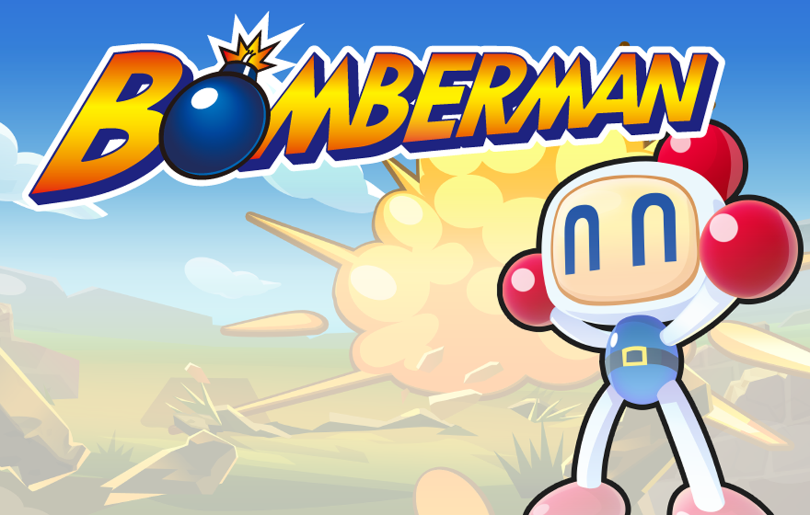

<p align="center">
  
</p>

<h1 align="center">Bomberman</h1>

<p align="center">
  <strong>A four-player Bomberman over TCP, written in C with SDL2.</strong><br>
  One window hosts the game, up to four windows join it with an IP and a port, and the server
  decides who moves, what explodes and which bonus drops.
</p>

<p align="center">
  <a href="#quick-start">Quick start</a> &middot;
  <a href="#how-it-works">How it works</a> &middot;
  <a href="#controls">Controls</a> &middot;
  <a href="#tech-stack">Tech stack</a> &middot;
  <a href="#documentation">Documentation</a>
</p>

<p align="center">
  
  
  
  
</p>

<p align="center">
  
  <br>
  <sub>The menu background of the game, drawn full screen behind the Join game and Create game
  buttons.</sub>
</p>

---

Bomberman is the classic arena game: players walk a grid of solid and breakable blocks, plant
bombs with a timer, and try to catch each other in the flames. Building it as a networked game
means two problems at once: a real-time renderer and a protocol that keeps every window in
agreement about where everybody is.

This repository holds the version written at ETNA as a school project. It was uploaded to GitHub
in March 2022 and is not maintained. A single binary, `bomberman`, plays both roles. From the
menu, **Create game** starts a server thread on the given IP and port and shows a waiting screen;
**Join game** connects to a server and opens the arena. The server owns the whole game state and
broadcasts every event as a short text message; clients only draw and send key presses.

## Quick start

**Prerequisites:** Linux with `gcc`, `make` and the development packages of SDL2, SDL2_image and
SDL2_ttf (`libsdl2-dev libsdl2-image-dev libsdl2-ttf-dev` on Debian and Ubuntu).

```sh
git clone https://github.com/verovec/Bomberman.git && cd Bomberman
make               # builds ./bomberman from src/*.c, linked with -pthread
./bomberman        # run from the repository root: images/ and fonts/ are loaded by relative path
```

Start one instance, choose **Create game**, press Enter twice to keep the defaults (port `5000`,
IP `127.0.0.1`). Start a second instance, choose **Join game**, press Enter twice again. The game
accepts moves once at least two players are connected, and up to four can join. To play over a
LAN, type the host's address instead of `127.0.0.1` on both sides: the server binds to the IP you
give it.

## How it works

```
  Menu          Join game or Create game, then a port and an IP typed in the window
     |
  Server        a thread binds a TCP socket, accepts up to 4 clients, one thread per client
     |
  Handshake     the client gets its player number, who is online, the map, bonuses and stats
     |
  Input         a key press becomes one character on the socket: 1 up, 2 down, 3 right, 4 left, 5 bomb
     |
  Simulation    the server moves players, plants bombs, explodes them after 4 s, drops bonuses
     |
  Broadcast     every change goes to all clients as a text message with a one-character prefix
     |
  Rendering     each client redraws map, bonuses, bombs, flames, players and HUD at every loop
```

The arena is 15 by 11 tiles. The outer ring and every other tile inside are solid; the rest is
drawn at random between grass and breakable blocks, with the four corners cleared so each player
can spawn. Everything that changes the game (a move, a bomb, an explosion, a picked bonus) is
computed once on the server and replayed by the clients, which animate it with sprite sheets
stepped on `SDL_GetTicks()`.

## Controls

| Key | Where | Action |
|-----|-------|--------|
| Up, Down | Menu | Select Join game or Create game |
| Enter | Menu | Validate the choice, then the port, then the IP |
| Backspace | Port and IP input | Erase the last character (digits and dots only) |
| Escape | Menu, waiting screen, game | Leave the current screen |
| Arrow keys | Game | Move one tile (delay given by the player's speed) |
| Space | Game | Plant a bomb on the current tile |

Every player starts with one life, two bombs at a time, a flame radius of one tile and a step
every 300 ms. Breaking a block drops a bonus most of the time: more bombs, more speed, a wider
radius, an extra life or one more simultaneous bomb. The HUD on the right shows the live values.

## Tech stack

| Layer | Tech | Location |
|-------|------|----------|
| Window, textures, text, input | SDL2, SDL2_image, SDL2_ttf | `src/init.c`, `src/draw.c`, `src/events.c` |
| Networking | POSIX TCP sockets, one `pthread` per client | `src/server.c`, `src/client.c` |
| Game rules | server-side simulation, bomb timers, bonuses | `src/events_server.c` |
| Client state | parsing of the server messages, HUD updates | `src/events_client.c` |
| Animations | sprite sheets stepped on `SDL_GetTicks()` | `src/animations.c` |
| Assets | menu, map tiles, characters, flames, bonuses, HUD, font | `images/`, `fonts/` |
| Build | Makefile, `gcc`, `-pthread` | `Makefile` |

Details in [Architecture](docs/architecture.md).

## Documentation

| Topic | Where |
|-------|-------|
| Files, game loop, server and client threads, state, bonuses | [`docs/architecture.md`](docs/architecture.md) |
| Message format exchanged between server and clients | [`docs/protocol.md`](docs/protocol.md) |
| Build, run, play on a LAN, clean up, known limits | [`docs/development.md`](docs/development.md) |
| Everything else | [`docs/`](docs/README.md) |

## Contributing

This repository is kept as is, as an archive of a school project. Issues are still welcome if you
find something worth noting, but no new development is planned.
